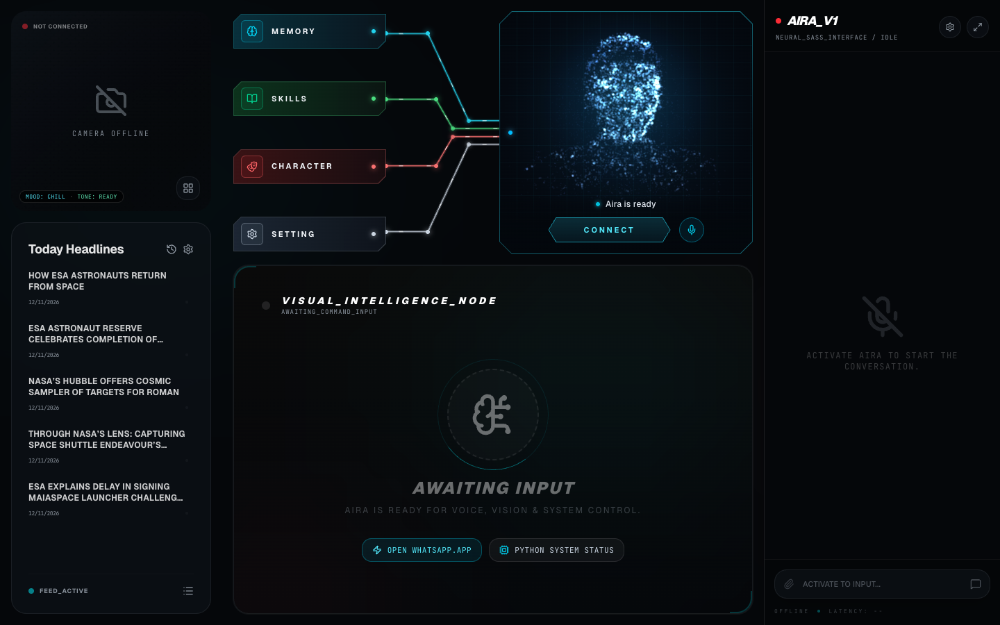

<div align="center">

# AIRA AI Assistant

**Open-Source Real-Time Voice, Vision & Autonomous macOS Desktop Control AI**

[](https://www.typescriptlang.org/)
[](https://react.dev/)
[](https://www.electronjs.org/)
[](https://ai.google.dev/)
[](https://threejs.org/)
[](https://www.python.org/)
[](#quick-start)

*A futuristic, open-source AI desktop companion powered by Google Gemini Live API, an interactive 3D particle hologram, webcam emotion awareness, persistent memory, and native Python-driven macOS system & screen automation.*

[Features](#key-features) • [Architecture](#tech-stack--architecture) • [Quick Start](#quick-start) • [macOS App Build](#macos-desktop-app-electron) • [FAQ (AEO)](#frequently-asked-questions) • [GitHub Topics](#recommended-github-topics)

</div>

---

## Interface Preview



---

## What is AIRA AI Assistant?

**AIRA AI Assistant** is an open-source, real-time multimodal AI assistant for **macOS** and the **web**. Built on the **Google Gemini Live API**, **React 19**, **Three.js**, **Electron**, **Express**, and **Python**, AIRA combines low-latency bidirectional voice conversation with a live **3D particle hologram**, **webcam emotion/mood detection**, **persistent memory & custom personas**, and **hands-free macOS desktop automation** (launching native apps, controlling system workflows, and reading/interacting with the screen).

Unlike text-only chatbots, AIRA runs as both a local web app and a native macOS Electron desktop application (`AIRA AI Assistant.app`) capable of executing real system tasks on your laptop.

---

## Key Features

- **Real-Time Bidirectional Voice (`Gemini Live API`)**: Natural, low-latency spoken conversations with customizable AI voices and personas.
- **Interactive 3D Hologram UI (`Three.js` / `@react-three/fiber`)**: Dynamic particle-mesh avatar that responds visually to listening, thinking, and speaking states.
- **Native macOS System & App Control (`python/system_agent.py`)**: Launch native macOS applications (e.g., WhatsApp, Chrome, Terminal, Finder), open URLs, and automate system actions via voice or chat commands.
- **Autonomous Screen Vision Agent (`/api/system/screen-task`)**: Captures screen context and performs multi-step UI understanding and desktop assistance.
- **Webcam Mood & Tone Awareness (`/api/vision/emotion`)**: Detects user mood/expression via camera (when enabled) and adapts AIRA's conversational tone in real time.
- **Neural Core Deck (`Memory`, `Skills`, `Character`, `Settings`)**:
  - **Memory**: Persistent context and user facts across sessions.
  - **Skills**: Modular capabilities and tool definitions.
  - **Character**: Customizable AI personality, tone, and system prompt.
  - **Settings**: Voice selection, audio/camera controls, and system preferences.
- **Visual Intelligence Node & Live Feed**: Central workspace for status cards, quick system actions, and live news headlines.

---

## Tech Stack & Architecture

| Layer | Technologies | Purpose |
| :--- | :--- | :--- |
| **Frontend UI** | React 19, TypeScript, Vite, Tailwind CSS v4, Motion | Responsive dark-glass cockpit UI & Neural Core modals |
| **3D Visualization** | Three.js, `@react-three/fiber`, `@react-three/drei`, `cobe` | Interactive 3D particle hologram & globe visuals |
| **AI & Voice** | `@google/genai` (Gemini Live API) | Real-time streaming audio, vision, and tool calling |
| **Backend Server** | Node.js, Express, `tsx`, `esbuild` | Local API server (`/api/config`, `/api/core`, `/api/system/*`, `/api/vision/*`) |
| **Desktop Shell** | Electron 45, `electron-builder` | Native macOS `.app` bundle with permissions management |
| **System Agent** | Python 3.10+ (`python/system_agent.py`) | macOS app launching, screen capture, and OS automation |

### Project Structure

```text
AIRA-AI-Assistant/
├── electron/               # Electron main & preload scripts (macOS desktop shell & permissions)
├── python/                 # Python system automation & screen agent (system_agent.py)
├── src/                    # React 19 frontend, 3D hologram, Neural Core UI & Gemini Live service
├── docs/screenshots/       # App screenshots for documentation
├── server.ts               # Express API & Vite dev/production server
├── index.html              # SEO, Open Graph & JSON-LD structured metadata
├── package.json            # Scripts & electron-builder macOS packaging config
└── .env.example            # Environment variable template
```

---

## Quick Start

### Prerequisites

- **Node.js** (v18+ recommended)
- **Python 3.10+** (for macOS system & screen automation)
- **Google Gemini API Key** ([Get one from Google AI Studio](https://aistudio.google.com/))

### 1. Clone & Install

```bash
git clone https://github.com/<your-username>/AIRA-AI-Assistant.git
cd AIRA-AI-Assistant
npm install
```

### 2. Configure Environment Variables

Copy `.env.example` to `.env` and add your Gemini API key:

```bash
cp .env.example .env
```

```env
GEMINI_API_KEY="YOUR_GEMINI_API_KEY"
APP_URL="http://localhost:3000"
```

> **Security Note:** `.env` is ignored by `.gitignore` so your API keys are never committed to GitHub.

### 3. Run in Development Mode

```bash
npm run dev
```

Open **`http://localhost:3000`** in your browser and click **CONNECT** to start talking with AIRA.

---

## macOS Desktop App (Electron)

To run AIRA as a standalone macOS desktop application with native system automation:

```bash
# Run Electron in dev/local mode
npm run electron

# Build production bundle + macOS .app (output in release/mac-arm64/)
npm run electron:build:mac
```

### Required macOS Permissions

For full voice, vision, and automation capabilities, grant the following permissions in **System Settings → Privacy & Security** when prompted:

| Permission | Reason |
| :--- | :--- |
| **Microphone** | Real-time bidirectional voice chat with AIRA |
| **Camera** | Optional webcam mood & emotion awareness |
| **Automation** | Launching and controlling macOS applications |
| **Screen Recording** | Reading screen context for the autonomous vision agent |

---

## Frequently Asked Questions

### What is AIRA AI Assistant?
AIRA AI Assistant is an open-source voice, vision, and desktop automation AI assistant built with Google Gemini Live API, React 19, Three.js, Electron, Express, and Python. It provides a 3D hologram interface and native macOS control.

### Does AIRA support real-time voice conversation?
Yes. AIRA uses the `@google/genai` Gemini Live API for low-latency, bidirectional audio streaming with selectable voices and custom personas.

### Can AIRA control macOS apps and read my screen?
Yes. Through `python/system_agent.py` and the `/api/system/python` and `/api/system/screen-task` endpoints, AIRA can open native macOS apps, run system commands, and analyze screen content with user permission.

### Can I run AIRA in a browser without Electron?
Yes. Running `npm run dev` starts the Express + Vite server at `http://localhost:3000`, allowing you to use the 3D hologram, voice chat, memory, skills, and persona features directly in any modern browser.

---

## Recommended GitHub Topics

To maximize discoverability in GitHub Search and AI Answer Engines, add these **Topics** in your GitHub repository settings (`About` → ⚙️):

```text
ai-assistant, gemini-live-api, voice-ai, electron-app, macos-automation, threejs, react, typescript, python-automation, multimodal-ai, desktop-agent, open-source-ai, hologram-ui, vision-ai, autonomous-agent
```

---

## Contributing

Contributions, issues, and feature requests are welcome!

1. Fork the repository
2. Create your feature branch (`git checkout -b feature/amazing-feature`)
3. Commit your changes (`git commit -m "Add amazing feature"`)
4. Push to the branch (`git push origin feature/amazing-feature`)
5. Open a Pull Request

---

## Author

Created and maintained by **Arvind Kumar** ([@arvindcodex](https://github.com/arvindcodex)).

## License

Licensed under the **Apache License, Version 2.0** — Copyright © 2026 **Arvind Kumar** ([@arvindcodex](https://github.com/arvindcodex)). See [LICENSE](LICENSE) for full details.
